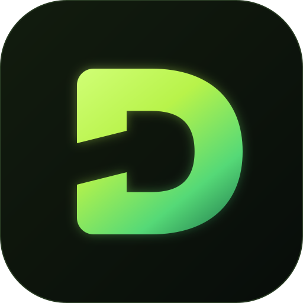
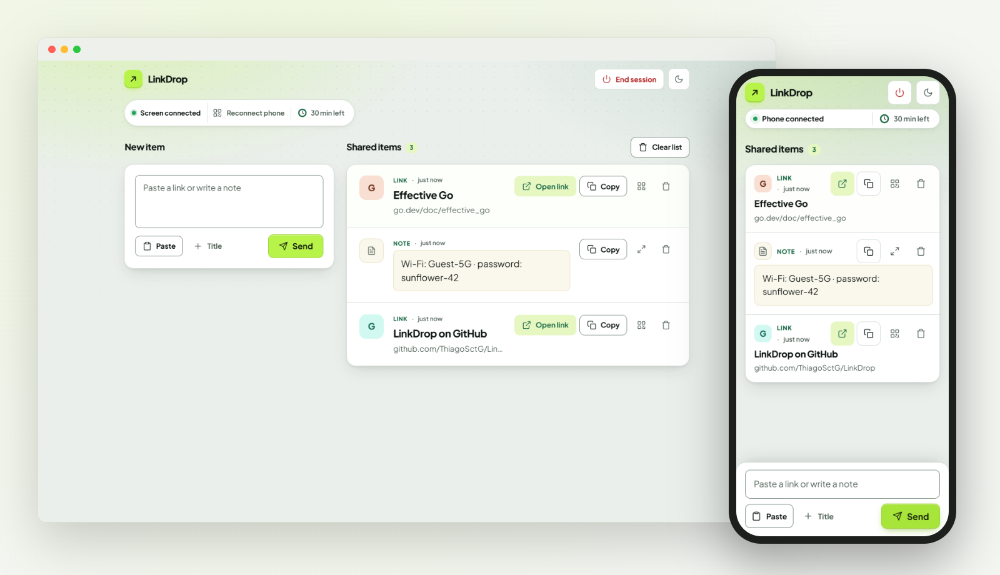

<div align="center">



# LinkDrop

**Passe links e notas entre o computador e o celular. Escaneie um QR Code e compartilhe uma lista ao vivo. Sem login, nada guardado.**

[](https://github.com/ThiagoSctG/LinkDrop/actions/workflows/ci.yml)
[](https://github.com/ThiagoSctG/LinkDrop/releases/latest)
[](LICENSE)

[English](README.md) · **Português**

</div>

<picture>
  <source media="(prefers-color-scheme: dark)" srcset="docs/images/hero-dark.png">
  
</picture>

## Por que o LinkDrop?

Levar um link do celular para a tela da sala de reunião, ou uma nota do notebook para o celular, normalmente significa mandar um e-mail para si mesmo ou entrar em um aplicativo de mensagens num computador que não é seu. O LinkDrop elimina esse passo: abra no computador, escaneie o QR Code, e os dois dispositivos compartilham uma lista até você encerrar a sessão.

## Recursos

- **Pareamento por QR Code** temporário. Sem contas e sem instalar aplicativo.
- **Lista ao vivo nos dois sentidos**, com links e notas e título opcional.
- **Feito para telas compartilhadas**: exiba um link como QR Code grande ou uma nota em tela cheia.
- **Efêmero**: tudo fica em memória e é apagado quando a sessão termina ou após 30 minutos sem atividade.
- **Auto-hospedado e leve**: um binário de ~7 MB ou uma imagem de contêiner multiarquitetura, temas claro e escuro, português e inglês.

## Começar

```bash
docker run -d --name linkdrop -p 47821:47821 ghcr.io/thiagosctg/linkdrop:v0.1.0
```

Abra `http://<IP-do-computador-na-rede>:47821` no computador e escaneie o QR Code com o celular. Os dois dispositivos precisam acessar esse endereço, então `localhost` não funciona para o celular.

**Outras opções:**

- **Docker Compose**: clone o repositório, copie `.env.example` para `.env` e rode `docker compose up -d`.
- **Binários** para Linux, macOS e Windows na página de [Releases](https://github.com/ThiagoSctG/LinkDrop/releases/latest), com checksums SHA-256. Eles não são assinados digitalmente.

## Configuração

Use variáveis de ambiente; valores inválidos impedem a inicialização com uma mensagem de erro.

| Variável | Padrão | Descrição |
| --- | --- | --- |
| `PORT` | `47821` | Porta de escuta (porta do host no Compose fornecido) |
| `PUBLIC_URL` | _vazio_ | Origem externa dos links de pareamento, ex.: `https://drop.example.com` |
| `TRUST_PROXY` | `false` | Confia em `X-Forwarded-For` e `X-Forwarded-Proto`; só atrás de um proxy |
| `SESSION_TTL` | `30m` | Tempo sem atividade até a sessão terminar |
| `PAIRING_TTL` | `2m` | Validade de um QR Code não escaneado |
| `MAX_ITEMS_PER_SESSION` | `100` | Máximo de itens por sessão |
| `RATE_LIMIT_REQUESTS` / `RATE_LIMIT_WINDOW` | `60` / `1m` | Requisições de API por IP a cada janela |
| `RATE_LIMIT_MAX_KEYS` | `10000` | IPs acompanhados simultaneamente |
| `LOG_LEVEL` | `info` | `debug`, `info`, `warn` ou `error` (JSON no stderr) |

Para acesso pela internet, coloque o LinkDrop atrás de um proxy HTTPS que encaminhe WebSockets, defina `PUBLIC_URL` e ative `TRUST_PROXY`. Com o [Caddy](https://caddyserver.com/), basta `reverse_proxy localhost:47821`.

## Segurança e privacidade

- Sem criptografia de ponta a ponta: o servidor consegue ler o conteúdo. Hospede sua própria instância ou use uma de confiança.
- O conteúdo fica em memória e nunca é gravado em disco nem em logs. Reiniciar o servidor encerra todas as sessões.
- Links de pareamento e chaves salvas no navegador dão acesso à sessão. Trate-os como credenciais.
- Execute uma única instância; as sessões não são compartilhadas entre réplicas.

Relate vulnerabilidades de forma privada, como descrito no [SECURITY.md](SECURITY.md).

## Desenvolvimento

Requer Go 1.26.10+ e Node.js 22+.

```bash
npm ci && npm run build
go run ./cmd/linkdrop      # http://localhost:47821
npm run dev                # opcional: hot reload em http://localhost:5173
```

Veja o [CONTRIBUTING.md](CONTRIBUTING.md) (em inglês) para arquitetura, testes e processo de release. Issues e pull requests são bem-vindos em português ou inglês.

## Licença

[MIT](LICENSE) · [Changelog](CHANGELOG.md)
